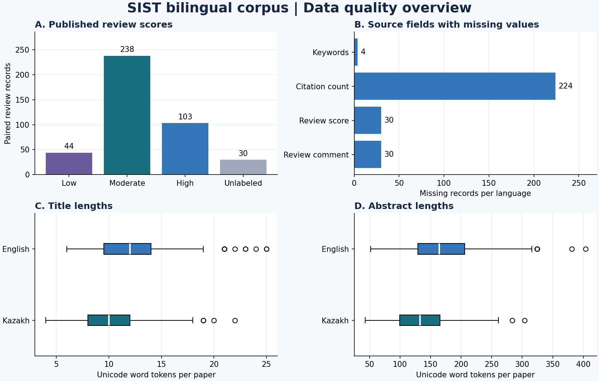

# Data quality and leakage audit

**Programming for AI · Topic 26 · Participant 1 · Nulimu Arey · AAI-2606M**

## Corpus and cleaning

The SIST English and Kazakh releases each contain 415 source rows. I joined them by the published row index (`Unnamed: 0`), validated a one-to-one join, and verified agreement on mapped scores, missing scores, citation counts, and the one-to-one mapping between normalized titles. The published index is a pairing key within these pinned releases. `paper_id` derives from the normalized English title and identifies the same paper in both languages.

The merged corpus contains **415 bilingual review pairs for 215 papers**. The training, validation and test files include the **385 scored pairs for 185 papers**. I kept the 30 unlabeled pairs in the merged corpus and excluded them from supervised splits. I mapped Төмен, Орташа and Жоғары to Low, Moderate and High. Both model inputs are the title and abstract for the corresponding language. Review comments, keywords, citations and source IDs are excluded from model features.

- [EN pinned CSV](https://huggingface.co/datasets/Arailym-tleubayeva/sist-english-corpus/resolve/bef7222ed5e05cb84bed63e31c28a77c40d389a6/Articles_SIST_clean.csv)
- [KK pinned CSV](https://huggingface.co/datasets/Arailym-tleubayeva/sist-kazakh-corpus/resolve/d21d147364c2a35c9eba2a3791da793c9e06d95e/Articles_SIST_clean_kaz.csv)

## Exploratory data analysis

| Label | Pairs | Share of labeled (%) |
| --- | --- | --- |
| Low | 44 | 11.4 |
| Moderate | 238 | 61.8 |
| High | 103 | 26.8 |
| Unlabeled | 30 | — |

| Source field | en | kk |
| --- | --- | --- |
| Unnamed: 0 | 0 | 0 |
| Title | 0 | 0 |
| Abstract | 0 | 0 |
| Keywords | 4 | 4 |
| CitationCount | 224 | 224 |
| normalized_title | 0 | 0 |
| Review_score | 30 | 30 |
| Review_comment | 30 | 30 |

**Duplicate reviews and label variation.** Identical full source rows after removing the exported index (EN 0, KK 0) differ from repeated reviews for the same paper. Among the labeled papers, 185 have multiple review records and **93 have more than one score category for the same title and abstract**. I kept these as separate reviewer observations. The target is an individual reviewer score, and identical input can therefore have different labels. Moderate represents 61.8% of labeled pairs, so macro-F1 and per-class recall are appropriate alongside accuracy.

**Text lengths.** Lengths use Unicode word tokens and one observation per paper, including unlabeled papers, to avoid double-counting repeated text. The median abstract is 164 tokens in English and 133 in Kazakh. These counts describe the corpus and differ from E5 subword token counts. I flagged lengths outside 1.5 IQR from the quartiles and retained them as observed text.

| Text field | min | 25% | 50% | 75% | max | IQR outliers |
| --- | --- | --- | --- | --- | --- | --- |
| title_en | 6.0 | 9.5 | 12.0 | 14.0 | 25.0 | 10 |
| title_kk | 4.0 | 8.0 | 10.0 | 12.0 | 22.0 | 4 |
| abstract_en | 52.0 | 129.0 | 164.0 | 206.0 | 404.0 | 4 |
| abstract_kk | 43.0 | 99.5 | 133.0 | 165.5 | 304.0 | 2 |

## Paper-level split and leakage audit

I grouped all reviews of a paper by normalized title and linked any distinct papers with identical normalized titles or abstracts, or near-identical abstracts in either language. For near duplicates, I compared sets of character 5-grams with Jaccard similarity ≥ 0.80. Matching ignored case, Unicode compatibility differences and extra whitespace. This lexical rule can miss paraphrases. It found **0 cross-paper match rows** under the specified rules. The train/validation/test partition comes from a group shuffle targeting 70%/15%/15%, with seed 26. Of 2,000 candidate assignments, the selected one minimizes squared relative deviations from the target per-class counts while requiring all three classes in every partition.

| Partition | Review pairs | Papers | Low | Moderate | High |
| --- | --- | --- | --- | --- | --- |
| train | 270 | 130 | 31 | 168 | 71 |
| validation | 57 | 27 | 6 | 35 | 16 |
| test | 58 | 28 | 7 | 35 | 16 |

| Partition A | Partition B | Shared papers (random rows) | Shared papers (grouped) |
| --- | --- | --- | --- |
| train | validation | 40 | 0 |
| train | test | 37 | 0 |
| validation | test | 11 | 0 |

Across all three partition pairs, the grouped split had zero shared paper IDs, duplicate-group IDs, normalized titles, exact titles, exact abstracts and detected near-duplicate abstracts in either language. The random-row comparison holds partition row counts constant and shows why a row-level split leaks. Full checks are in `leakage_audit.csv` and `03_data_leakage.ipynb`.

## Model handoff and limitations

Use the supplied split files for both languages and both models. Fit TF-IDF and classifiers on `train.csv`, choose settings on `validation.csv`, and reserve `test.csv` for the final paired comparison. Join predictions on `review_id` and account for the shared `paper_id` when quantifying uncertainty. The same review labels appear on both language versions, so language-specific results use matched examples from a small, single-conference corpus. The minority class has 7 test reviews. The dataset measures published reviewer categories and cannot establish general paper quality.
